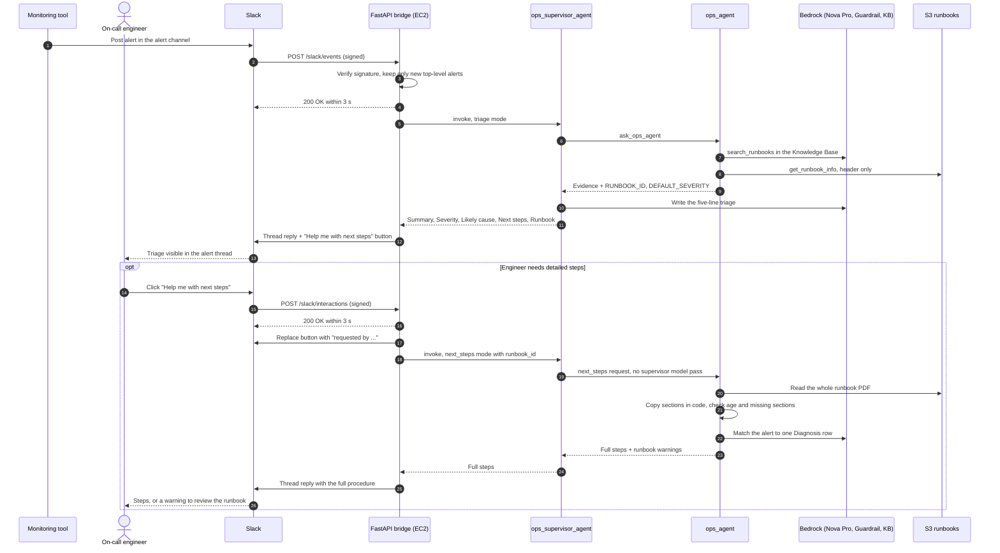

# Ops Agent: Slack-driven alert triage on Amazon Bedrock AgentCore

Alerts posted in a Slack channel are triaged by an AI supervisor agent. It rates each alert, asks a specialist
agent for evidence (recent deployments, related alerts, matching runbook), and replies in the alert's thread.
When a runbook matches, the reply has a **Help me with next steps** button that posts the runbook's full,
step-by-step procedure, and warns when the runbook looks outdated or incomplete.

Region: set by `AWS_REGION` in `.env`. Every command below uses `[YOUR-AWS-REGION]` and `[YOUR-AWS-PROFILE]` as
placeholders; replace them with your own values.

## Architecture

```mermaid
flowchart LR
    monitor(["Monitoring tool"])
    user(["On-call engineer"])

    subgraph slack["Slack workspace"]
        channel["Alert channel"]
        app["Slack app: ops-supervisor<br/>Events API + Interactivity"]
    end

    subgraph aws["AWS account"]
        apigw["API Gateway HTTP API<br/>POST /slack/events<br/>POST /slack/interactions<br/>GET /health"]
        subgraph vpc["VPC, private network"]
            vpclink["VPC link"]
            cloudmap["Cloud Map<br/>ops-bridge / bridge"]
            ec2["EC2 t4g.small<br/>FastAPI bridge container"]
        end
        secrets["Secrets Manager<br/>ops-supervisor/slack"]
        ecr["ECR<br/>ops-bridge image"]
        subgraph agentcore["Bedrock AgentCore Runtime"]
            supervisor["ops_supervisor_agent<br/>triage + next_steps modes"]
            opsagent["ops_agent<br/>deployments, alerts, runbooks"]
        end
        subgraph bedrock["Amazon Bedrock, LLM layer"]
            nova["Nova Pro LLM"]
            guardrail["Guardrail"]
            kb["Knowledge Base<br/>Titan Embeddings V2 + S3 Vectors"]
        end
        s3["S3 runbook bucket<br/>runbooks/RB-NNN-*.pdf"]
    end

    monitor -->|posts alert| channel
    user -->|reads replies, clicks button| channel
    channel --> app
    app -->|signed HTTPS events and clicks| apigw
    apigw -.->|service lookup| cloudmap
    apigw --> vpclink --> ec2
    ec2 -->|read Slack secrets| secrets
    ecr -.->|image pull| ec2
    ec2 -->|invoke_agent_runtime| supervisor
    supervisor -->|ask_ops_agent, next_steps| opsagent
    supervisor -->|reasoning| nova
    opsagent -->|reasoning, symptom match| nova
    nova --- guardrail
    opsagent -->|search runbooks| kb
    kb -.->|indexes| s3
    opsagent -->|read whole runbook PDF| s3
    ec2 -->|chat.postMessage, chat.update| app
```



Solid arrows are requests; dotted arrows are background relationships (service lookup, image pull, Knowledge Base indexing). The guardrail is applied to every model call.

## User flow

What happens from the moment an alert is posted, and when someone asks for detailed steps.



## How replies work

| | Triage reply (every alert) | Next steps (on button click) |
|---|---|---|
| Trigger | New top-level message in the alert channel | **Help me with next steps** |
| Content | Summary, Severity, Likely cause, Next steps, `Runbook: RB-NNN` | Matched symptom, First 5 minutes, Mitigation, Escalation, Verify recovery |
| Runbook source | Knowledge Base search (fragments) + runbook header | Whole runbook PDF from S3 |
| Severity | Copied from the runbook's default (SEV1 = critical, SEV2 = high) | Shown in the runbook line |
| Model use | Supervisor + `ops_agent` agent loops | One small call to match the Diagnosis row; steps are copied by code |
| Warnings | | `Runbook warning` when the runbook is older than `max_age_days`, lacks a required section, or has no Diagnosis row for the alert |

Steps are copied by code, not by the model, so none can be dropped, merged or invented. The full runbook is
only read when someone asks, which keeps the per-alert token cost low.

Secrets (Slack bot token and signing secret) live only in AWS Secrets Manager. `.env` holds non-secret settings.
No AWS access keys are stored anywhere: locally the AWS CLI profile is used, in the cloud each component uses its
own IAM role.

## Repository layout

| Path | Purpose |
|---|---|
| `app.py` | AgentCore entrypoint for `ops_agent`; modes: normal and `next_steps` |
| `supervisor_app.py` | AgentCore entrypoint for `ops_supervisor_agent`; modes: triage and `next_steps` |
| `src/agents/ops_agent.py` | Specialist agent: deployments, alerts, runbook search; `next_steps_reply()` |
| `src/agents/ops_supervisor_agent.py` | Supervisor agent: rates alerts, routes to specialists |
| `src/tools/ops_tools.py` | `ops_agent` tools (sample data + Knowledge Base search) |
| `src/tools/runbook_tools.py` | Reads one runbook PDF from S3; section splitter, age and section checks; `get_runbook_info`, `get_runbook` tools |
| `src/tools/supervisor_tools.py` | `ask_ops_agent` tool and `request_next_steps()` (call the deployed `ops_agent`) |
| `src/api/main.py` | FastAPI bridge: `/slack/events`, `/slack/interactions`, `/health` |
| `src/api/slack.py` | Slack helpers: secrets, signature check, event and click parsing, Slack formatting, button, thread reply |
| `config/settings.py` | Loads `.env` and the YAML files below |
| `config/*.yaml` | Agent prompts, model settings, timeouts, runbook policy, logging |
| `data/knowledge_base/runbooks/` | Runbook PDFs (RB-001 to RB-010) for the Knowledge Base |
| `Dockerfile.bridge` | Container image for the FastAPI bridge |
| `scripts/launch.sh` | Deploys one agent to AgentCore with all `.env` values except `AWS_PROFILE` |
| `scripts/sandbox.sh` | Starts, stops or checks the bridge EC2 |
| `scripts/send_test_event.py` | Sends Slack-signed test requests to the bridge |
| `scripts/iam/*.example.json` | IAM policy templates; copy to `*.json` (git-ignored) and fill in your values |
| `examples/sample_alerts.yaml` | 22 sample alerts grouped by expected runbook |

## Prerequisites

- An AWS account and an AWS CLI v2 profile with admin-level rights for setup (`aws configure --profile [YOUR-AWS-PROFILE]`).
- A region that offers Bedrock AgentCore Runtime, Bedrock Knowledge Bases with S3 Vectors, and the models below.
- Bedrock model access in that region for **Amazon Nova Pro** (`amazon.nova-pro-v1:0`) and **Amazon Titan Text Embeddings V2**.
- Python 3.12 or later.
- Docker (Docker Desktop or similar) running locally.
- A Slack workspace where you can create apps.

## 1. Local setup

```bash
git clone [REPO-URL] ops-agent && cd ops-agent
python3 -m venv .venv
source .venv/bin/activate          # repeat in every new terminal
pip install -r requirements.txt    # all packages are pinned here; never pip install packages directly
cp .env.example .env
```

If the repository contains `.bedrock_agentcore.yaml` or a `.bedrock_agentcore/` folder from someone else's
deployment, delete them. The toolkit writes your own versions in steps 3 and 4.

Optional: the AgentCore starter toolkit prints a deprecation notice on every command. To hide it:

```bash
export AGENTCORE_SUPPRESS_RECOMMENDATION=1
```

Fill `.env` as you go. Final contents:

```
AWS_PROFILE=[YOUR-AWS-PROFILE]
AWS_REGION=[YOUR-AWS-REGION]
MODEL_ID=amazon.nova-pro-v1:0
RUNBOOK_BUCKET=[RUNBOOK-BUCKET-NAME]
KNOWLEDGE_BASE_ID=[KNOWLEDGE-BASE-ID]
GUARDRAIL_ID=[GUARDRAIL-ID]
GUARDRAIL_VERSION=[GUARDRAIL-VERSION]
OPS_AGENT_RUNTIME_ARN=[OPS-AGENT-RUNTIME-ARN]
SLACK_SECRET_ID=ops-supervisor/slack
SLACK_ALERT_CHANNEL_ID=[SLACK-CHANNEL-ID]
SUPERVISOR_RUNTIME_ARN=[SUPERVISOR-RUNTIME-ARN]
```

Make sure the last line of `.env` ends with a newline.

## 2. Knowledge Base and Guardrail (AWS console)

**Runbook bucket**
1. S3, create a bucket `[RUNBOOK-BUCKET-NAME]` in `[YOUR-AWS-REGION]`.
2. Create a folder `runbooks/` in it and upload every PDF from `data/knowledge_base/runbooks/` into that folder.
   The folder name must match `s3_prefix` in `config/environment_config.yaml`.

**Runbook format.** The next-steps feature reads runbooks by structure, so each PDF needs:
- a file name starting with its ID, for example `RB-003-sfcc-job-failed-or-stuck.pdf`;
- the title, with a line `Runbook RB-NNN` directly below it;
- header fields `Default severity SEV1|SEV2` and `Last reviewed YYYY-MM-DD`;
- the headings listed under `runbooks.required_sections` (by default First 5 minutes, Diagnosis, Mitigation,
  Escalation, Verify recovery), each on its own line, with numbered steps or bullets under them;
- a Diagnosis table with Symptom, Likely cause and How to confirm columns.

Runbook policy lives in `config/environment_config.yaml`:

```yaml
runbooks:
  max_age_days: 180      # older "Last reviewed" dates trigger a runbook warning
  s3_prefix: runbooks/   # folder in RUNBOOK_BUCKET that holds the PDFs
  required_sections:     # missing headings trigger a runbook warning
    - First 5 minutes
    - Diagnosis
    - Mitigation
    - Escalation
    - Verify recovery
```

Runbooks are read fresh from S3 on every next-steps request, so an edited runbook is used at once without a
redeploy. Re-sync the Knowledge Base after uploading changes so triage search sees them too.

**Knowledge Base**
1. Bedrock, Knowledge Bases, create a knowledge base with a vector store.
2. Data source: the S3 bucket above. Embeddings model: Titan Text Embeddings V2. Vector store: quick create with S3 Vectors.
3. After it is created, select the data source and click **Sync**.
4. Copy the Knowledge Base ID into `KNOWLEDGE_BASE_ID`.

**Guardrail**
1. Bedrock, Guardrails, create a guardrail.
2. Content filters (harmful categories): Medium. Prompt attacks: High, on input only.
3. Sensitive information (PII): block or mask the types you care about.
4. Create a version (for example `1`). Copy the guardrail ID into `GUARDRAIL_ID` and the version into `GUARDRAIL_VERSION`.
   Use a numbered version, not `DRAFT`.

Check that the agent works locally:

```bash
python -m src.agents.ops_agent
```

## 3. Deploy `ops_agent` to AgentCore

```bash
agentcore configure -e app.py -n ops_agent -r [YOUR-AWS-REGION]
```

Answer the prompts: execution role auto-create, ECR auto-create, dependency file `requirements.txt`,
no OAuth, no request header allowlist, no memory.

```bash
./scripts/launch.sh ops_agent
```

`launch.sh` passes every `.env` value except `AWS_PROFILE` to the runtime with `--env`. The container never
sees `.env` itself, and in AWS it uses its IAM role instead of a profile.

Find the runtime's execution role and ARN:

```bash
grep -n "agent_arn:\|execution_role:" .bedrock_agentcore.yaml
```

Grant the role access to the Knowledge Base, the guardrail and the runbook files (read-only, `runbooks/` folder
only). Copy the template, then replace every `[PLACEHOLDER]` in the copy with your values:

```bash
cp scripts/iam/ops-agent-policy.example.json scripts/iam/ops-agent-policy.json
```

```bash
aws iam put-role-policy --role-name [OPS-AGENT-EXECUTION-ROLE-NAME] --policy-name ops-agent-kb-guardrail \
  --policy-document file://scripts/iam/ops-agent-policy.json --profile [YOUR-AWS-PROFILE]
```

Test, then copy the `ops_agent` runtime ARN into `OPS_AGENT_RUNTIME_ARN` in `.env`:

```bash
agentcore invoke '{"prompt": "Checkout payment errors are spiking. What changed recently and which runbook applies?"}' -a ops_agent
```

## 4. Deploy `ops_supervisor_agent` to AgentCore

`OPS_AGENT_RUNTIME_ARN` must be in `.env` before this step.

```bash
agentcore configure -e supervisor_app.py -n ops_supervisor_agent -r [YOUR-AWS-REGION]
./scripts/launch.sh ops_supervisor_agent
```

`configure` makes the new agent the toolkit's default. Always pass `-a <agent>` to `agentcore invoke`, and an
agent name to `launch.sh`.

Grant the supervisor's execution role (a different role from `ops_agent`'s) permission to call `ops_agent` and to
apply the guardrail. Copy the template and fill in its placeholders:

```bash
cp scripts/iam/ops-supervisor-policy.example.json scripts/iam/ops-supervisor-policy.json
```

```bash
aws iam put-role-policy --role-name [SUPERVISOR-EXECUTION-ROLE-NAME] --policy-name ops-supervisor-invoke-guardrail \
  --policy-document file://scripts/iam/ops-supervisor-policy.json --profile [YOUR-AWS-PROFILE]
```

Test, then copy the supervisor runtime ARN into `SUPERVISOR_RUNTIME_ARN` in `.env`:

```bash
agentcore invoke '{"prompt": "[FIRING] checkout: payment error rate 12% (threshold 2%) for 10 minutes."}' -a ops_supervisor_agent
```

## 5. Slack app

1. https://api.slack.com/apps, **Create New App**, **From scratch**. Name it, pick your workspace.
2. **OAuth & Permissions**, **Bot Token Scopes**: add `chat:write`, `channels:history`, `channels:read`.
3. **Install to Workspace**, **Allow**. Keep the **Bot User OAuth Token** (`xoxb-...`) for step 6.
   Whenever you change scopes, click **Reinstall to Workspace**.
4. **Basic Information**, **App Credentials**: keep the **Signing Secret** for step 6.
5. **Settings**, **Socket Mode**: leave it **off**. With Socket Mode on, Slack ignores the Request URL and no
   events reach the bridge.
6. In Slack, create a public alert channel and run `/invite @[YOUR-BOT-NAME]` in it.
7. Get the channel ID (channel details, bottom of the **About** tab, starts with `C`) and put it in `SLACK_ALERT_CHANNEL_ID`.

Do not set the Event Subscriptions Request URL yet. Slack verifies it immediately, so the API must be live first (step 10).

Treat the bot token and signing secret like passwords. Never put them in `.env`, code, the image, or chat.

## 6. Slack secrets in Secrets Manager (console)

1. Secrets Manager in `[YOUR-AWS-REGION]`, **Store a new secret**, **Other type of secret**.
2. Key/value pairs: `bot_token` = the `xoxb-...` token, `signing_secret` = the signing secret.
3. Encryption key: `aws/secretsmanager`. Secret name: `ops-supervisor/slack`. Rotation: off.

Check without printing the values:

```bash
aws secretsmanager get-secret-value --secret-id ops-supervisor/slack --query SecretString --output text \
  --region [YOUR-AWS-REGION] --profile [YOUR-AWS-PROFILE] \
  | python -c "import sys, json; d = json.loads(sys.stdin.read()); print(sorted(d), d['bot_token'].startswith('xoxb-'))"
```

## 7. Test the bridge locally

Terminal 1:

```bash
uvicorn src.api.main:app --port 8000
```

Terminal 2:

```bash
PYTHONPATH=. python scripts/send_test_event.py challenge   # expect 200 {"challenge": ...}
PYTHONPATH=. python scripts/send_test_event.py forged      # expect 401 {"error":"invalid signature"}
PYTHONPATH=. python scripts/send_test_event.py alert       # expect 200 {"ok":true}, then a triage reply in Slack
PYTHONPATH=. python scripts/send_test_event.py click       # expect 200 {"ok":true}, button replaced, full steps in Slack
```

The `click` case posts a test alert and a ready-made triage reply with a button, then sends the signed click Slack
would send, so only the next-steps path runs. To test through API Gateway instead of localhost, set
`BRIDGE_URL=[API-ENDPOINT]/slack/events` and `BRIDGE_INTERACTIONS_URL=[API-ENDPOINT]/slack/interactions`.

## 8. Build the image and push it to ECR

The image architecture must match the EC2 instance. These steps use an arm64 (Graviton) instance. On an
x86 machine, add `--platform linux/arm64` to `docker build`.

```bash
docker build -f Dockerfile.bridge -t ops-bridge:local .
```

Optional local run (mounts your AWS profile read-only; for local testing only):

```bash
docker run --rm -d --name ops-bridge -p 8000:8000 --env-file .env -v ~/.aws:/home/appuser/.aws:ro ops-bridge:local
```

Create a private ECR repository named `ops-bridge` (console: Elastic Container Registry, Create repository), then:

```bash
ACCOUNT_ID=$(aws sts get-caller-identity --query Account --output text --profile [YOUR-AWS-PROFILE])
REGISTRY=$ACCOUNT_ID.dkr.ecr.[YOUR-AWS-REGION].amazonaws.com
aws ecr get-login-password --region [YOUR-AWS-REGION] --profile [YOUR-AWS-PROFILE] \
  | docker login --username AWS --password-stdin $REGISTRY
docker tag ops-bridge:local $REGISTRY/ops-bridge:v1
docker push $REGISTRY/ops-bridge:v1
```

## 9. EC2 host for the bridge

**IAM role** (console: IAM, Roles, Create role, AWS service, EC2), named `ops-bridge-ec2-role`:
- Managed policies: `AmazonSSMManagedInstanceCore`, `AmazonEC2ContainerRegistryReadOnly`.
- Inline policy `ops-bridge-runtime-access`: copy the template, fill in its placeholders, then attach it:

```bash
cp scripts/iam/ops-bridge-ec2-policy.example.json scripts/iam/ops-bridge-ec2-policy.json
aws iam put-role-policy --role-name ops-bridge-ec2-role --policy-name ops-bridge-runtime-access \
  --policy-document file://scripts/iam/ops-bridge-ec2-policy.json --profile [YOUR-AWS-PROFILE]
```

**Instance** (console: EC2, Launch instances):
- Name `ops-bridge`. AMI: Amazon Linux 2023, 64-bit (Arm). Type: `t4g.small`. Key pair: none (Session Manager is used).
- Network: default VPC, public IP enabled. New security group `ops-bridge-sg` with **no inbound rules**
  (remove the default SSH rule). Step 10 adds the only inbound rule.
- Advanced details: IAM instance profile `ops-bridge-ec2-role`; Metadata version **V2 only**;
  Metadata response hop limit **2** (with 1, the container cannot get IAM credentials).
- User data:

```bash
#!/bin/bash
dnf install -y docker
systemctl enable --now docker
```

**Run the container** (EC2, Connect, Session Manager):

```bash
sudo dnf install -y nano && sudo mkdir -p /opt/ops-bridge && sudo nano /opt/ops-bridge/bridge.env
```

`/opt/ops-bridge/bridge.env` (no `AWS_PROFILE`, so the instance role is used):

```
AWS_REGION=[YOUR-AWS-REGION]
SLACK_SECRET_ID=ops-supervisor/slack
SLACK_ALERT_CHANNEL_ID=[SLACK-CHANNEL-ID]
SUPERVISOR_RUNTIME_ARN=[SUPERVISOR-RUNTIME-ARN]
```

```bash
ACCOUNT_ID=$(aws sts get-caller-identity --query Account --output text)
REGISTRY=$ACCOUNT_ID.dkr.ecr.[YOUR-AWS-REGION].amazonaws.com
aws ecr get-login-password --region [YOUR-AWS-REGION] | sudo docker login --username AWS --password-stdin $REGISTRY
sudo docker run -d --name ops-bridge --restart unless-stopped -p 8000:8000 \
  --env-file /opt/ops-bridge/bridge.env $REGISTRY/ops-bridge:v1
sudo docker logs ops-bridge 2>&1 | grep ops_bridge    # expect: Slack secrets loaded; bridge ready
```

## 10. Private HTTPS endpoint (API Gateway, VPC link, Cloud Map)

1. **Cloud Map**: create namespace `ops-bridge` (instance discovery: API calls), service `bridge`, and register a
   service instance: type **IP address**, ID `ops-bridge-ec2`, IPv4 = the instance's **private** IP, port `8000`.
2. **Security groups**: create `ops-bridge-vpclink-sg` (no inbound rules). In `ops-bridge-sg`, add inbound
   TCP `8000` from source `ops-bridge-vpclink-sg`.
3. **VPC link**: API Gateway, VPC links, create a **VPC link for HTTP APIs** in the default VPC, all subnets,
   security group `ops-bridge-vpclink-sg`. Wait for `Available`.
4. **HTTP API** `ops-bridge-api`: create it empty, add routes `POST /slack/events`, `POST /slack/interactions` and
   `GET /health`, then attach one **Private resource** integration to all three: target service Cloud Map, namespace
   `ops-bridge`, service `bridge`, VPC link `ops-bridge-vpclink`. Keep the `$default` stage with auto-deploy.
   Only these routes exist, so FastAPI's `/docs` and every other path stay unreachable from the internet.

Test:

```bash
API=$(aws apigatewayv2 get-apis --query 'Items[?Name==`ops-bridge-api`].ApiEndpoint' --output text \
  --region [YOUR-AWS-REGION] --profile [YOUR-AWS-PROFILE])
curl -s $API/health                                                   # {"status":"ok"}
BRIDGE_URL=$API/slack/events PYTHONPATH=. python scripts/send_test_event.py challenge
curl -s -X POST "$API/slack/interactions" -d 'payload={}' -w ' %{http_code}\n'   # {"error":"invalid signature"} 401
```

## 11. Connect Slack

1. Slack app, **Event Subscriptions**: enable events, Request URL `[API-ENDPOINT]/slack/events` (wait for
   **Verified**), subscribe to the bot event `message.channels`, **Save Changes**, reinstall if asked.
2. Slack app, **Interactivity & Shortcuts**: turn **Interactivity** on, Request URL
   `[API-ENDPOINT]/slack/interactions`, **Save Changes**. Slack does not test this URL on save; the first click does.

Post an alert as a new top-level message in the alert channel. A triage reply appears in its thread within about
a minute; when it names a runbook it has a **Help me with next steps** button. A click replaces the button with
"Next steps requested by ..." (so it can't run twice) and posts the full procedure in the thread a few seconds later.
Replies inside threads, including the bot's own, are ignored. `examples/sample_alerts.yaml` has 22 alerts grouped
by the runbook each should map to.

## Daily operations

```bash
./scripts/sandbox.sh status    # EC2 state and bridge health through API Gateway
./scripts/sandbox.sh stop      # stop the EC2 when not testing (alerts posted while stopped are lost)
./scripts/sandbox.sh start     # start it again and wait until the bridge is healthy
```

The private IP survives stop and start, so Cloud Map and the VPC link keep working. After a start, check that the
Slack app's Event Subscriptions page still shows the Request URL as verified.

**Redeploy an agent** after changing its code, prompts (`config/agent_config.yaml`), runbook policy or `.env`
values. Agents bake `config/` into their image, so YAML changes need a redeploy too. Deploy `ops_agent` first
when both change, because the supervisor depends on it:

```bash
./scripts/launch.sh ops_agent              # or ops_supervisor_agent
aws bedrock-agentcore-control get-agent-runtime --agent-runtime-id [RUNTIME-ID] \
  --query '[agentRuntimeVersion,status,lastUpdatedAt]' --output text   # wait for READY before testing
```

**Redeploy the bridge** after changing `src/api/`: build, tag a new version (for example `v3`), push, then on the
EC2 (Session Manager terminal, not your laptop):

```bash
sudo docker pull $REGISTRY/ops-bridge:v3
sudo docker rm -f ops-bridge
sudo docker run -d --name ops-bridge --restart unless-stopped -p 8000:8000 \
  --env-file /opt/ops-bridge/bridge.env $REGISTRY/ops-bridge:v3
```

To roll back, run the same commands with the previous tag. Keep old tags in ECR until the new one is proven.

## Troubleshooting

| Symptom | Likely cause | Fix |
|---|---|---|
| Runtime returns 500, logs show `modelId` is `None` | Runtime deployed without `.env` values | Deploy with `./scripts/launch.sh <agent>`, not a bare `agentcore launch` |
| `ops_agent call failed: AccessDenied` | Supervisor role lacks `InvokeAgentRuntime` | Check the step 4 inline policy and its ARNs |
| Bridge fails at startup reading the secret | Role cannot read the secret, or hop limit is 1 | Check `ops-bridge-ec2-role` and set metadata hop limit to 2 |
| Slack messages produce no `POST /slack/events` in the logs | Socket Mode is on, or Event Subscriptions disabled | Turn Socket Mode off and re-save the Request URL |
| `missing_scope` from Slack | Scope added without reinstalling | **Reinstall to Workspace** |
| `401 invalid signature` for real Slack events | Wrong signing secret in Secrets Manager | Update the secret, restart the container |
| `Cannot connect to the Docker daemon` | Docker Desktop not running | Start Docker Desktop |
| Reply contains `<thinking>` text | Model reasoning leaked | Both `supervisor_app.py` and the bridge strip it; redeploy if an old version is running |
| Clicking the button shows an error icon in Slack | Interactivity Request URL missing, or the API route `POST /slack/interactions` not attached | Set the URL (step 11) and check the route (step 10) |
| Triage reply has no button | The reply has no `Runbook: RB-NNN` line (no runbook matched, or triage failed) | Expected for unmatched alerts; otherwise check the supervisor prompt and redeploy |
| Next steps say `Runbook lookup failed: ... AccessDenied` | `ops_agent`'s role cannot read the runbook folder | Re-apply `ops-agent-policy.json` with the S3 statements (step 3) |
| Next steps say `Runbook lookup failed: No runbook file found` | PDF not under `s3_prefix`, or its name doesn't start with the ID | Upload as `runbooks/RB-NNN-....pdf` |
| `Runbook warning: ... may be outdated` on every runbook | `max_age_days` too low (for example a test value) | Set it back in `config/environment_config.yaml` and redeploy `ops_agent` |
| A next-steps answer is missing a section | The runbook lacks that heading, or the heading text differs | Match the headings in `runbooks.required_sections` exactly |
| `agentcore invoke` says credentials may be expired | `AWS_PROFILE` not set in this terminal | `export AWS_PROFILE=[YOUR-AWS-PROFILE]` |

## Cost and cleanup

Billed while idle: the EC2 instance (about $15 to $20 a month running, under $1 stopped), the Secrets Manager
secret (about $0.40 a month), Cloud Map (about $0.10 a month), and storage in ECR and S3 Vectors (cents).
AgentCore runtimes, API Gateway, the VPC link and Bedrock are billed per use. Check current prices for your region.

A triage costs roughly one to two cents in model calls. A next-steps click costs a fraction of a cent, because only
the small symptom-matching call uses the model.

Delete in this order when finished: Slack Event Subscriptions and Interactivity; API Gateway API and VPC link; Cloud Map
service and namespace; EC2 instance, its security groups and `ops-bridge-ec2-role`; ECR repository `ops-bridge`;
the secret; both runtimes (`agentcore destroy -a <agent>`), their execution roles, inline policies and log
groups; the Knowledge Base and its S3 Vectors store; the runbook bucket; the guardrail; finally the Slack app.

## POC limitations

- The bridge hands alerts to the supervisor with FastAPI `BackgroundTasks`, inside the container. A restart
  mid-triage loses that alert. Production should put alerts on a queue (for example SQS) and process them in a worker.
- Slack retries are skipped only when Slack reports a timeout. Production should deduplicate by `event_id`
  in shared storage (for example DynamoDB).
- A single EC2 instance has no redundancy. In production, run the same image as several pods behind a Kubernetes
  Ingress with TLS, and give pods their own IAM role (IRSA or EKS Pod Identity).
- `ops_agent`'s deployment and alert tools return sample data. Connect them to your real CI/CD and monitoring.
- The runbook reader expects the PDF layout described in step 2. Runbooks in another format (Confluence, Markdown,
  scanned PDFs) need their own section splitter.
- Anyone in the alert channel can click the next-steps button. Each click is a paid call, and the button is removed
  after the first click.
- The AgentCore starter toolkit used here is deprecated in favour of the AgentCore CLI (`@aws/agentcore`).